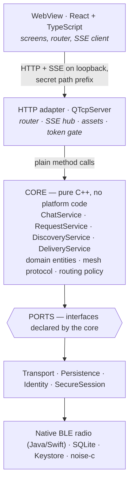
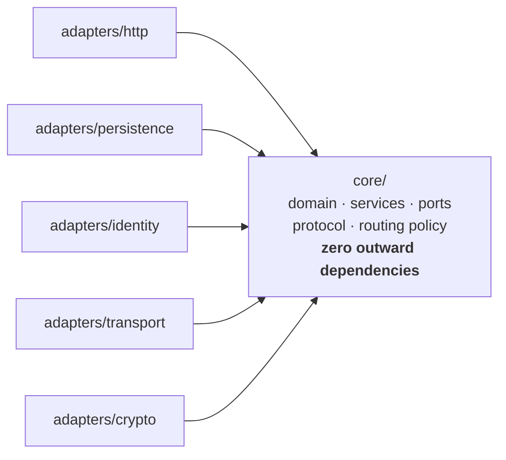
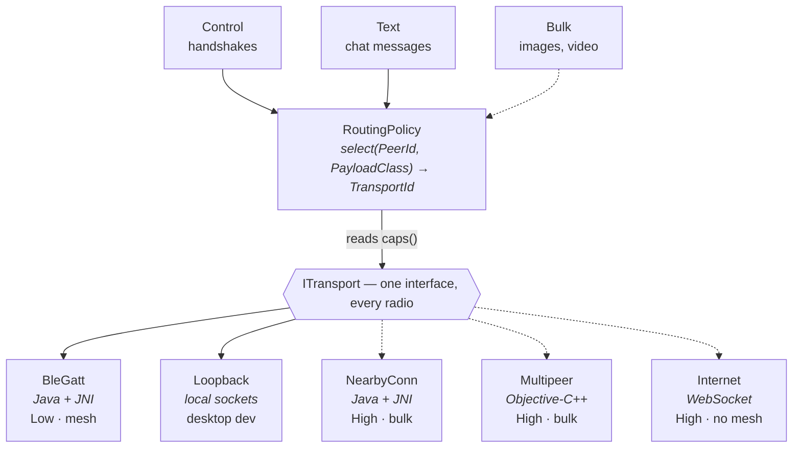
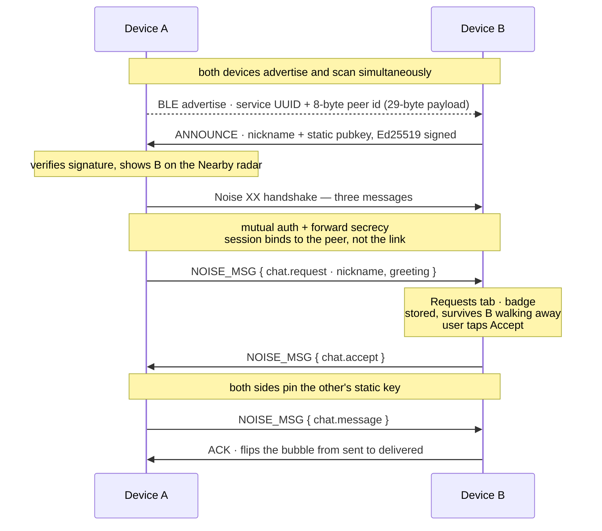
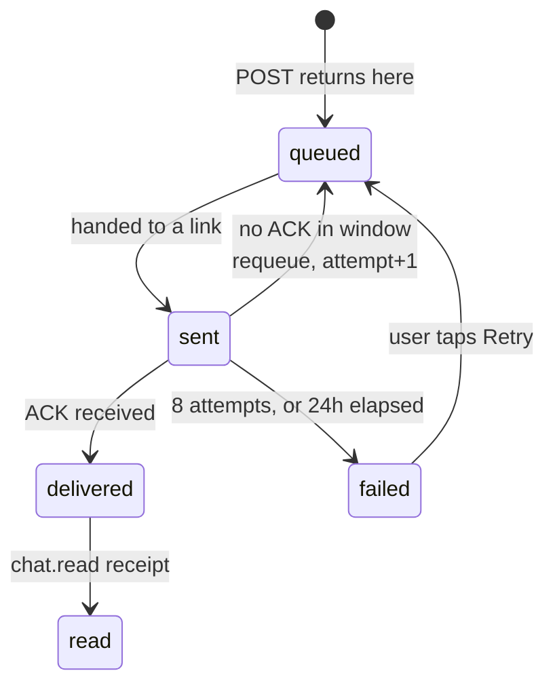
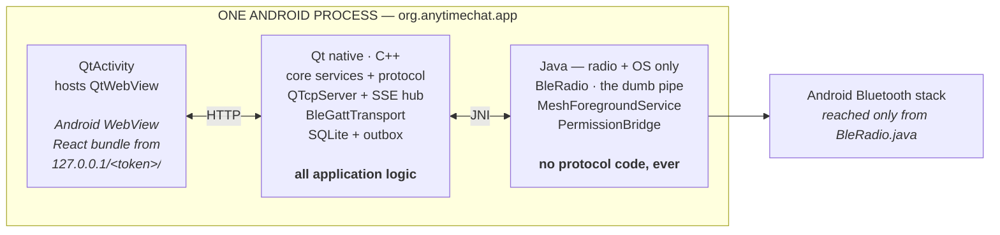

# AnyTime Chat — Architecture

**Offline-first nearby messaging, built once in C++.**

A BLE mesh chat app with no server, no account provider, and no second implementation
language. One Qt/C++ core drives a React WebView through a local HTTP surface, and
reaches the radio through a transport seam that Google Nearby and Apple Multipeer can
slot into later.

| | |
|---|---|
| **Status** | Rev B — decisions settled, implementation starting |
| **Stack** | Qt 6.11 / C++17 · Vite + React 19 + TS · native BLE GATT · Noise XX |
| **Target** | Android first, iOS ready |
| **Presentation copy** | https://claude.ai/code/artifact/63c17bd1-b80a-4163-a903-31164487e9c8 |

---

## 01 · Scope & constraints

**Version 1 is text-only, offline-only, one-to-one.** Two people in Bluetooth range
discover each other, one sends a request, the other accepts, and they chat. No images,
no video, no voice, no group chats, no internet. An account is a username, date of birth
and gender, created on the device and registered nowhere.

### The three rules everything derives from

1. **One application language.** C++ owns the whole application. Platform languages own
   only the radio — Java on Android, Swift or Objective-C++ on iOS — behind one C++
   interface. The protocol is never written twice.
2. **Extensible transports.** BLE carries v1. The transport seam must accept Google
   Nearby Connections and Apple Multipeer Connectivity later, for image and video
   transfer, without the chat layer noticing the difference.
3. **Correctness over speed.** No deadline pressure. Prefer the design that is still
   clean at phase 5 over the one that reaches phase 2 a month sooner.

### What bitchat is to this project

Because we are not writing Kotlin, [bitchat](https://github.com/permissionlesstech/bitchat)
is **a specification we read**, not code we lift. Its
[whitepaper](https://github.com/permissionlesstech/bitchat/blob/main/WHITEPAPER.md) has
already solved, in public and under the Unlicense, the genuinely hard parts of BLE mesh:
packet framing, TTL and relay damping, duplicate suppression, fragment sizing, announce
cadence, and offline store-and-forward. We implement those ideas in C++ and cite the source.

We do **not** inherit its application model. bitchat is ephemeral, anonymous and
IRC-shaped; AnyTime is persistent, request-gated and one-to-one.

### What FunMeet is to this project

A stack reference only. FunMeet is a thin client in front of `api.techyskitter.com`; its
local server exists purely so Firebase sees an HTTP origin instead of `file://`. Here the
local server **is** the backend. We take its Qt shell, its WebView loading pattern and its
Vite build pipeline, and leave behind the `findWebView()` retry loop it needs to inject a
JavaScript bridge.

---

## 02 · Decision record

| ID | Decision | Status |
|---|---|---|
| AD-01 | Protocol and mesh logic live in C++, not a platform language | Revised |
| AD-02 | BLE written natively per platform, behind one C++ interface | Revised |
| AD-03 | Hand-rolled HTTP and SSE on `QTcpServer` | Decided |
| AD-04 | Our own protocol identity, bitchat-derived design | Decided |
| AD-05 | Identity is a keypair; the username is only a label | Decided |
| AD-06 | Noise XX from an existing library, behind our own interface | Decided |
| AD-07 | The loopback transport is a deliverable, not a test double | Decided |
| AD-08 | The local API is gated by a secret path prefix, not a bearer token | Decided |
| AD-09 | Multi-hop relay: build the fields now, enable the behaviour later | **Open** |

### AD-01 — Protocol and mesh logic live in C++

An earlier draft proposed lifting bitchat-android's Kotlin services behind a JNI seam.
Rejected on the one-language constraint. The cost is that we implement the mesh ourselves;
the return is a single implementation that Android and iOS both run, in one language, with
one debugger and one set of tests.

### AD-02 — BLE written natively per platform

Qt Bluetooth is out. The radio is Java on Android and Swift or Objective-C++ on iOS,
reached over JNI, implementing `ITransport`. Its licence was never the problem — the
reason to drop it is that a mesh needs simultaneous advertising, scanning and several
concurrent GATT links, which is the least-exercised path in Qt's Android backend. Every
shipping mesh app reaches the platform APIs directly, bitchat-android included.

**The binding rule:** the native layer stays a *dumb pipe*. Bytes in, bytes out, no
protocol logic. See section 11.

### AD-03 — Hand-rolled HTTP and SSE on QTcpServer

Qt HTTP Server ships under **GPLv3 or commercial**, with no LGPL option, so linking it
would relicense the entire application. Qt Network is LGPL, and a loopback-only router
with an SSE hub is a few hundred lines. This is the one place we copy FunMeet's approach
directly rather than improving on it.

### AD-04 — Our own protocol identity

Own service UUID, own version byte, no wire compatibility with the public bitchat network.
Four reasons, in order of weight:

**a. The interop would not actually work.** Our core loop is request → accept → chat.
bitchat has no packet type for a request awaiting acceptance, because it has no such
concept. A bitchat user would receive our request as an unactionable blob — *there is no
accept button in their app*. We would appear in each other's peer lists and be unable to
complete a single meaningful interaction.

**b. We would inherit their header permanently.** Group chats want a conversation id; the
bulk-transport handoff wants a transport hint; internet routing wants its own addressing.
None can be added without breaking compatibility — and the moment we add the first field
we have forked anyway, into a fork that looks confusingly like the original.

**c. It punches through the request gate.** Request-gating exists so strangers cannot
message you unsolicited. bitchat is open-broadcast by design, so compatible clients could
inject past our gate — unless we filter them, at which point we are not interoperating.
There is also a moderation problem: unmoderated mesh content surfacing inside a 13+ app is
a store-review risk.

**d. We would inherit their release schedule.** If they change the padding scheme or
announce format, we either follow on their timeline or diverge silently and break in the
field.

**What we keep anyway.** The valuable part is free either way, because the design is
public domain: TTL 7 with adaptive clamping, LRU dedup at 1000 entries over 5 minutes,
fragment sizing, announce cadence, the 60-second reachability window, outbox limits,
padding buckets. We change only the service UUID and a header shaped for directed
one-to-one traffic.

**The hedge:** stay structurally similar — same field concepts, same sizes, same ordering
— so that if compatibility is ever wanted, the gap is small.

**Why this is time-sensitive.** Today the wire format is a paragraph and changing it costs
an afternoon. After phase 1 the codec exists, its tests exist, and the outbox holds
serialised payloads in that format. After the first shipped user it means version
negotiation and a compatibility window.

### AD-05 — Identity is a keypair

Curve25519 static key, SHA-256 fingerprint, first eight bytes as the stable peer ID —
bitchat's model. Usernames are display strings and may collide; the UI disambiguates with
a short fingerprint suffix such as `@vinay·4f2a`. The `/account/username-available`
endpoint in the UI draft is removed.

### AD-06 — Noise XX from an existing library

[noise-c](https://github.com/rweather/noise-c) is MIT-licensed plain C with a libsodium
backend, so we get a reviewed handshake state machine instead of a hand-written one. It
sits behind `ISecureSession`, so swapping it for a focused in-house XX implementation
later touches nothing above the seam. Validate either choice against the published Noise
test vectors.

### AD-07 — The loopback transport is a deliverable

**We are deliberately never writing a desktop radio.** Radio implementations are Java
(Android) and Swift (iOS) only; there will never be a Windows, macOS or Linux BLE
implementation in this project. So the desktop has *zero* radio, by design — loopback is
the only way anything runs on a development machine.

What it buys:

- **The whole product exists before any radio does.** Phase 0 delivers a complete,
  demoable app — discovery, requests, accept, chat, delivery states — with zero Bluetooth
  code written.
- **Seconds per iteration instead of minutes.** Two desktop windows, breakpoints on both
  sides of a conversation, no deploy step, no two-handset dance.
- **Deliberate hostility.** Impairment knobs — inject 30% packet loss, add 500 ms latency,
  reorder frames, kill a link mid-handshake — are how you actually test outbox retry,
  dedup, and reassembly timeouts. You cannot do that reliably by walking around with
  phones.
- **CI becomes possible.** A test binary spins up N loopback instances in-process and runs
  whole multi-device scenarios headlessly.
- **It proves the seam is real while the seam is still soft.** Two independent
  implementations is the minimum needed to know an abstraction isn't accidentally shaped
  around one of them. If the loopback transport can't be written cleanly against
  `ITransport`, the interface is wrong — and that is free to fix in phase 0, expensive in
  phase 2.

**Deliverable, not test double** means it lives in `adapters/`, not `tests/`; it is held
to production quality; and the desktop build is a supported configuration run every day,
so it cannot silently rot.

**Planned upgrade:** start with direct socket connections (everyone sees everyone). When
relay work begins (AD-09), replace it with a small hub process that models radio topology
— A hears B, B hears C, A cannot hear C — giving deterministic multi-hop testing on one
machine.

### AD-08 — Secret path prefix, not a bearer token

Android's loopback interface is shared by every app on the device. A token injected into
the page after load can be read back out by anything that fetches `index.html` first. A
256-bit path prefix chosen at launch is unguessable, is known to the WebView because C++
hands it the URL, and needs no injection step. See section 10.

### AD-09 — Multi-hop relay *(open)*

The packet header carries TTL and the dedup cache exists from phase 1, so turning relay on
is a policy flip rather than a format change. Whether v1 actually relays or stays
direct-range deserves a decision on evidence, because relaying multiplies both battery cost
and test surface. **Lean: direct-only for the first release.**

---

## 03 · Licensing gate

> **The trap.** Qt HTTP Server is GPLv3-or-commercial with no LGPLv3 option. Linking it
> into a closed-source app forces GPLv3 on the whole application. FunMeet avoids this only
> because it hand-rolled `QTcpServer`.

| Component | Licence | Use | Note |
|---|---|---|---|
| Qt Core / Network / Quick | LGPLv3 | ✅ | Dynamic linking keeps your source closed |
| Qt WebView | LGPLv3 / GPLv2 | ✅ | Native platform WebView on mobile |
| Qt WebEngine | LGPLv3 | Desktop | Development shell only, never shipped to mobile |
| Qt Sql | LGPLv3 | ✅ | SQLite driver plugin must be deployed |
| **Qt HTTP Server** | **GPLv3 / commercial** | ❌ | Would relicense the entire application |
| Qt Bluetooth | LGPLv3 / GPLv2 | Dropped | Licence was fine; superseded by native radios |
| Android BLE APIs | Platform | ✅ | `BluetoothLeAdvertiser`, `BluetoothGattServer`, scanner |
| libsodium | ISC | ✅ | X25519, Ed25519, ChaCha20-Poly1305, BLAKE2 |
| noise-c | MIT | ✅ | Noise XX and X handshakes |
| SQLite | Public domain | ✅ | Amalgamation is a viable alternative to Qt Sql |
| bitchat design | Unlicense | ✅ | Public domain — ideas and prose both reusable |

**The practical rule:** link Qt dynamically, ship the LGPL written offer, and keep
`QHttpServer` out of the build.

---

## 04 · Layered architecture



Only the bottom band is platform-specific. **Porting to iOS replaces that band and leaves
the four services, the domain and the protocol untouched.** Everything above the PORTS
line compiles and runs on a desktop with no radio present.

### Dependency direction



Every arrow points at the core. The core imports none of these — it only names their
interfaces. Nothing in `core/` includes a JNI header, a SQLite header or a network header.

**Enforce it in CI** with a grep over includes. It takes ten minutes to write and prevents
the slow erosion that kills this kind of architecture.

---

## 05 · Ports & adapters

```cpp
// core/ports/ITransport.h — one radio or link technology
class ITransport {
public:
    virtual ~ITransport() = default;

    virtual TransportId           id()   const = 0;
    virtual TransportCapabilities caps() const = 0;

    virtual Result start() = 0;
    virtual void   stop()  = 0;

    virtual Result startDiscovery(DiscoveryMode) = 0;
    virtual void   stopDiscovery() = 0;

    virtual Result openLink(const PeerHandle&) = 0;
    virtual void   closeLink(LinkId) = 0;
    virtual Result send(LinkId, ByteSpan frame) = 0;

    // observer, not Qt signals — core stays Qt-free
    virtual void setListener(ITransportListener*) = 0;
};

// What the routing policy reads to choose a transport
struct TransportCapabilities {
    uint32_t   maxFramePayload;     // bytes per frame after headers
    uint32_t   throughputClass;     // 0 = Low (BLE), 1 = Medium, 2 = High (Wi-Fi)
    bool       supportsBulk;        // images and video are worth sending here
    bool       supportsMesh;        // can relay for third parties
    bool       requiresUserConsent; // Nearby and Multipeer show system UI
    EnergyCost energyCost;
};
```

Remaining contracts, abbreviated:

| Port | Responsibility |
|---|---|
| `IIdentityStore` | Long-term Curve25519 + Ed25519 pairs; `loadOrCreate()`, `wipe()` |
| `ISecureSession` | One Noise session with one peer; handshake, encrypt, decrypt |
| `IMessageRepository` | Append, set status, page history |
| `IContactRepository` | Contacts, requests, block list |
| `IAccountRepository` | The single local account |
| `IOutbox` | Pending sends, attempt counts, expiry |
| `IClock` | Injectable — tests run without sleeping |
| `IEventSink` | Core emits; the HTTP adapter turns these into SSE |

### Local API surface

Every route sits under the secret prefix, written here as `/{t}`.

| Method & path | Purpose |
|---|---|
| `GET /{t}/api/account` | Current account, or 404 before setup |
| `POST /{t}/api/account` | Create account — generates the keypair |
| `PATCH /{t}/api/account` | Update label, discoverability, who may send requests |
| `POST /{t}/api/discovery` | Start advertising and scanning |
| `DELETE /{t}/api/discovery` | Stop the radio |
| `GET /{t}/api/discovery/peers` | Currently reachable peers with RSSI band |
| `POST /{t}/api/requests` | Send a chat request to a peer id |
| `GET /{t}/api/requests` | Inbound requests awaiting a decision |
| `POST /{t}/api/requests/:id/accept` | Accept — pins their static key, creates the chat |
| `POST /{t}/api/requests/:id/decline` | Decline, optionally block |
| `GET /{t}/api/chats` | Chat list with last message and unread count |
| `GET /{t}/api/chats/:id/messages` | Paged history, `?before=` cursor |
| `POST /{t}/api/chats/:id/messages` | Enqueue a message; returns immediately as `queued` |
| `GET /{t}/api/events` | **SSE stream** — the push channel |

SSE event names: `peer.discovered`, `peer.lost`, `request.received`, `request.accepted`,
`message.received`, `message.status`, `radio.state`.

---

## 06 · Transport abstraction



Solid = ships in v1. Dashed = added later as a new class, with no core changes.

### The handoff pattern

This is the same Bluetooth-discovers / Wi-Fi-carries handoff that Nearby Connections and
Multipeer both do internally, except we run it one level up so it works across both. Three
properties make it possible:

- **A peer is a key fingerprint, not an address.** `PeerId` is transport-independent, so
  the same person seen over BLE and over Wi-Fi is one identity.
- **A peer may hold several links at once.** `PeerSession` owns a set of `LinkId`s across
  different transports and picks per payload.
- **The Noise session binds to the peer, not the link.** You handshake once over BLE; the
  resulting cipher state encrypts a video sent over Nearby Connections minutes later. No
  second handshake, no second trust decision.

> **Consequence for v1:** because bulk transports arrive later, `RoutingPolicy` is trivial
> — everything goes over BLE. Write it as a real policy object anyway. The whole point is
> that phase 5 edits one class instead of threading a new concept through the services.

---

## 07 · Mesh protocol

### Packet layout

```
 0       1       2       3       4       5       6       7
+-------+-------+-------+-------+-------+-------+-------+-------+
| ver   | type  | ttl   | flags |     timestamp (u32, seconds)  |
+-------+-------+-------+-------+-------+-------+-------+-------+
|            sender id — first 8 bytes of key fingerprint       |
+---------------------------------------------------------------+
|   recipient id — 8 bytes, absent when broadcast (flag bit 0)  |
+---------------------------------------------------------------+
| payload length (u16) | payload … (Noise ciphertext if directed)|
+---------------------------------------------------------------+
|        [ Ed25519 signature — 64 bytes, ANNOUNCE only ]        |
+---------------------------------------------------------------+
```

Fixed header is 12 bytes, plus 8 for the recipient on directed packets.

### Parameters, and where they come from

| Parameter | Value | Rationale |
|---|---|---|
| Initial TTL | 7 | bitchat's figure; clamped to 5 on dense graphs of 6+ links |
| Dedup cache | 1000 entries / 5 min | LRU keyed on sender, timestamp, type, payload digest |
| Fragment payload | ~180 B | Deliberately below bitchat's 469 — see section 11 |
| Reassembly limit | 128 concurrent / 30 s | Bounded so a hostile peer cannot exhaust memory |
| Announce, isolated | every 4 s | Fast discovery when nobody is around |
| Announce, connected | 15–30 s jittered | Backs off once peers are known; jitter avoids sync storms |
| Peer reachable window | 60 s | Missing three announces marks a peer lost |
| Outbox retention | 100 msgs / peer, 24 h | With an 8-attempt resend cap |
| Encrypted padding | 256/512/1024/2048 | Buckets hide plaintext length |

### Packet types

```
ANNOUNCE          nickname, static pubkey, signing pubkey · Ed25519 signed
NOISE_HANDSHAKE   XX pattern, three messages
NOISE_MSG         encrypted envelope — carries every app payload below
FRAGMENT          8-byte fragment id, index, total
ACK               delivery confirmation for one message id

// app payloads, CBOR-encoded inside NOISE_MSG
chat.request      nickname, optional greeting
chat.accept       pins the requester's static key
chat.decline
chat.message      body, client message id, sent-at
chat.read         read receipt for a message id
```

> **Why CBOR for the app layer.** `QCborStreamWriter` and `QCborValue` are in QtCore under
> LGPL, so no new dependency. CBOR is compact on a byte-starved link, and unknown map keys
> are skippable — an older build can receive a newer message type without crashing.

---

## 08 · Request & chat flow



Nothing here contacts a server. Every arrow is one BLE link between two handsets.

The **accept** step is where trust is established: both devices pin the other's static
key, which is what stops a later device reusing a nickname from impersonating a known
contact.

### Anti-abuse, because there is no server to do it for you

- Rate-limit inbound requests per peer id — a fixed small number per hour, enforced locally
- Honour the account's `acceptFrom` setting — everyone, or nobody while heads-down
- A block list keyed on **fingerprint**, not nickname, so blocking actually sticks
- Discoverability is a toggle; when off, the device stops advertising entirely

---

## 09 · Delivery & outbox



The UI never blocks on the radio: `POST` returns at `queued`, and every later transition
arrives as a `message.status` event over SSE.

The outbox is **durable, not in-memory**. A message survives the app being killed, the
phone rebooting, and the peer being away for hours. When `DiscoveryService` reports that a
peer with pending mail is reachable again, `DeliveryService` drains that peer's queue in
order.

> **Deferred to phase 3+.** bitchat's *courier envelopes* — where a third device carries
> sealed mail for a peer it cannot itself read — are genuinely clever and genuinely
> complex, involving rotating recipient tags and copy budgets. They only pay off with real
> user density. Keep the sender-side outbox for v1.

---

## 10 · Security model

### On the air

| Property | Mechanism |
|---|---|
| **Confidentiality** | Every directed payload rides inside a Noise XX session — X25519, ChaCha20-Poly1305, SHA-256. Relays forward opaque ciphertext. Encrypted packets padded into 256/512/1024/2048-byte buckets |
| **Authenticity** | Announces carry an Ed25519 signature. Accepting a request pins the peer's static key to the contact |
| **At rest** | Message bodies encrypted with a key held in the Android Keystore, reached over JNI. Identity keypair wrapped the same way. Panic wipe clears both |
| **Still observable** | Announces are cleartext by design — a passive listener learns nicknames, public keys and rough presence. Inherent to open discovery; state it plainly in privacy copy |

### On localhost — the part bitchat never had to solve

bitchat does nothing like this, because it is a native Compose/SwiftUI app with no WebView
and no local HTTP server. The threat is created entirely by our architecture.

Android's loopback interface is shared by every app on the device. Any installed app can
open `http://127.0.0.1:PORT/` and, if it finds our server, read the entire chat history.
Four measures together close it:

| Measure | What it stops |
|---|---|
| **Ephemeral port** — bind 127.0.0.1 with port 0 | Trivial fixed-port probing. Raises cost, not a defence on its own |
| **Secret path prefix** — 256-bit, regenerated each launch | The real gate. Every route lives under `/{token}/…`; anything else gets 404 with no hint a server exists |
| **Host and Origin validation** | DNS rebinding, where a hostile page resolves a domain to 127.0.0.1 |
| **No CORS headers at all** | A malicious web page reading responses even if it guesses the URL |

The prefix beats a bearer token because it is **race-free**. C++ generates it, builds the
URL, and hands the WebView `http://127.0.0.1:41xxx/<token>/`. Relative URLs inside the page
inherit the prefix automatically. There is no window in which the page has loaded but not
yet received its credential — precisely the gap a post-load `runJavaScript` injection leaves
open.

> Also check that the accepted socket's peer address is loopback and refuse everything else.
> Three lines, and it closes the case where a future change accidentally binds a wider
> interface.

---

## 11 · The radio seam

BLE is written natively on each platform. **Exactly where that line falls is what decides
whether the protocol gets written once or twice.**

### The line: a dumb pipe, not a mesh

This table is the most important one in the document. If any row migrates from right to
left, the iOS port doubles in cost.

| Native layer owns — per platform | C++ core owns — written once |
|---|---|
| Advertising the service UUID + 8-byte peer id | Packet framing, parsing, version negotiation |
| Scanning, filtered on our service UUID | TTL, relay decisions, LRU dedup cache |
| GATT server — one service, one write characteristic, one notify characteristic | Fragmentation and reassembly |
| GATT client — connect, discover, subscribe, write | Noise handshakes and session state |
| MTU request, fire and forget | Announce scheduling and signature verification |
| Adapter state and runtime permissions | Outbox, retries, delivery states |
| **Emitting four events upward:** peerSeen, linkUp, linkDown, frame | Routing policy across transports, and everything above |

> **Why the line sits exactly there.** Anything on the left gets written twice — once in
> Java, once in Swift. Anything on the right gets written once and runs on both.
> Fragmentation is the tempting one to push down, because MTU lives in the radio; resist
> it. Send the fragment size *up* as a capability and let C++ do the splitting, or you will
> be debugging two reassembly implementations that disagree.

### The whole Java surface

```java
// platform/android/src/com/anytimechat/ble/BleRadio.java
// Nine methods down, five callbacks up. Nothing here knows what a packet means.

public final class BleRadio {
    // ── called from C++ over JNI ────────────────────────────
    public void    start(String serviceUuid, byte[] peerId);
    public void    stop();
    public void    startAdvertising();
    public void    stopAdvertising();
    public void    startScanning();
    public void    stopScanning();
    public int     openLink(String deviceAddress);   // → linkId
    public void    closeLink(int linkId);
    public boolean send(int linkId, byte[] frame);

    // ── native callbacks, implemented in C++ ────────────────
    private static native void onPeerSeen(byte[] peerId, String addr, int rssi);
    private static native void onLinkUp(int linkId, byte[] peerId);
    private static native void onLinkDown(int linkId, int reason);
    private static native void onFrame(int linkId, byte[] frame);
    private static native void onRadioState(int state);
}
```

The iOS class will have the same nine methods and the same five callbacks, backed by
`CBPeripheralManager` and `CBCentralManager`. **That symmetry is the deliverable** — if the
Swift surface starts growing methods the Java one lacks, protocol logic has leaked downward.

### Threading — the bug you will hit

Android delivers BLE callbacks on **binder threads**, not your thread. The C++ core is
single-threaded by design, because that is the simplest thing that is correct.

**Every JNI callback must therefore be posted onto the core's event loop before it touches
core state.** Skip this and you get intermittent corruption under concurrent links — the
hardest class of bug to reproduce, and it will look like a radio problem rather than a
threading one.

Attach a bounded lock-free queue at the JNI boundary and drain it on the core thread. Do it
on day one of the transport work, not after the first mysterious crash.

### Liveness still comes from announce packets

BLE connection callbacks are unreliable across *every* platform, not just Qt — iOS in
particular only infers that a central connected once it tries to read or write. So a peer
is reachable because a signed `ANNOUNCE` arrived inside the last 60 seconds, and three
missed announces mark it lost. Link events become a resource-management concern rather than
a correctness one, on both platforms, for free.

Two related rules: **never query MTU to size fragments** — use a fixed conservative ~180
bytes — and advertise only the service UUID plus the peer id, because the advertising
payload is capped at 29 usable bytes on Android regardless of who writes the code.

---

## 12 · Persistence

```sql
account      id · username · dob · gender · discoverable · accept_from
             static_sk_wrapped · static_pk · signing_sk_wrapped · signing_pk

peer         peer_id (8 B, PK) · static_pk · nickname · last_seen_at
             rssi_band · verified_announce_at

contact      peer_id (FK) · pinned_static_pk · display_name
             created_at · blocked_at

request      id · peer_id · direction (in|out) · greeting
             state (pending|accepted|declined) · created_at

chat         id · peer_id (FK) · created_at · last_message_at · unread

message      id · chat_id (FK) · client_msg_id · direction
             body_encrypted · status · created_at · delivered_at · read_at

outbox       message_id (FK) · peer_id · attempts · next_attempt_at
             expires_at · payload_encrypted

-- indices that matter
message(chat_id, created_at DESC)   -- history paging
outbox(peer_id, next_attempt_at)    -- drain when a peer reappears
peer(last_seen_at)                  -- the Nearby list
```

Run SQLite in **WAL mode**. `body_encrypted` and `payload_encrypted` hold
ChaCha20-Poly1305 ciphertext under a key from the Android Keystore, so a device backup or
filesystem dump yields nothing readable.

**Qt Sql or the amalgamation?** Qt Sql is simpler and already in the build; its wrinkle is
that the SQLite driver plugin must be deployed with the app, a known Android packaging
annoyance. The amalgamation is a single public-domain C file with no plugin step. Either
sits behind `IMessageRepository`, so this is reversible — start with Qt Sql and switch only
if deployment bites.

---

## 13 · Repository layout

```
AnytimeChat/
├─ CMakeLists.txt
├─ app/                          # Qt shell — the only QML in the project
│  ├─ main.cpp                   # wires adapters into core, starts server
│  ├─ MainWebView.qml            # Android/iOS — QtWebView
│  └─ MainWebEngine.qml          # desktop dev — QtWebEngine
│
├─ core/                         # ← pure C++17. no Qt, no SQLite, no platform
│  ├─ domain/                    # Account Peer Contact Request Chat Message
│  ├─ ports/                     # ITransport IIdentityStore ISecureSession
│  │                             # IMessageRepository IContactRepository
│  │                             # IOutbox IClock IEventSink
│  ├─ protocol/                  # packet codec, dedup, fragments, CBOR envelopes
│  └─ services/                  # Chat Request Discovery Delivery RoutingPolicy
│
├─ adapters/                     # ← everything platform-shaped lives here
│  ├─ http/                      # QTcpServer router, SSE hub, asset server
│  ├─ persistence/sqlite/        # repository implementations
│  ├─ transport/ble/             # BleGattTransport — JNI binding + thread hop
│  ├─ transport/loopback/        # two desktop instances, no radio  (AD-07)
│  ├─ identity/android/          # Keystore wrap via JNI
│  └─ crypto/                    # noise-c binding behind ISecureSession
│
├─ platform/android/
│  ├─ AndroidManifest.xml
│  ├─ build.gradle
│  └─ src/com/anytimechat/       # Java — radio and OS access only. No protocol.
│     ├─ ble/BleRadio.java            # the dumb pipe — 9 methods, 5 callbacks
│     ├─ MeshForegroundService.java   # keeps the process alive
│     └─ PermissionBridge.java        # runtime permission prompts
│
├─ platform/ios/                 # phase 5 — same 9 methods, same 5 callbacks
│  └─ BleRadio.swift             # CBPeripheralManager + CBCentralManager
│
├─ ui/                           # Vite + React + TS — from claude_design/src_v1
│  ├─ src/api/client.ts          # base URL gains the secret prefix
│  ├─ src/api/events.ts          # new — SSE subscription
│  └─ src/screens/               # Welcome Setup Nearby Chats Chat Requests Profile
│
├─ tests/                        # GoogleTest against core/ with fakes
└─ docs/                         # this document, protocol spec, ADRs
```

> **Note on the UI.** The `claude_design/src_v1` draft moves in nearly unchanged. Three
> edits: drop the username-availability check (AD-05), add `RequestsScreen` — `BottomNav`
> already links `/requests` but no screen exists yet — and replace `NearbyScreen`'s polling
> loop with the SSE subscription.

---

## 14 · Android process model



The foreground service keeps the whole process alive, so the C++ mesh survives the user
leaving the app. Frames cross JNI as byte arrays and are posted onto the core thread before
touching any core state.

### Manifest requirements

```xml
BLUETOOTH_SCAN        android:usesPermissionFlags="neverForLocation"
BLUETOOTH_ADVERTISE   <!-- peripheral role -->
BLUETOOTH_CONNECT     <!-- GATT links -->
FOREGROUND_SERVICE
FOREGROUND_SERVICE_CONNECTED_DEVICE
POST_NOTIFICATIONS    <!-- runtime-requested, Android 13+ -->
<!-- plus a battery-optimisation exemption prompt, or the mesh dies overnight -->
```

The `neverForLocation` flag is worth the care it takes: without it Android requires fine
location permission for BLE scanning, a hostile prompt for a chat app and a reasonable
cause of install abandonment. We do not derive location, so we are entitled to declare it.

---

## 15 · Delivery phases

| Phase | Deliverable | Proves |
|---|---|---|
| **0** | **Walking skeleton.** Qt shell, QTcpServer router with SSE, Vite UI wired up, loopback transport. Two desktop instances complete discovery → request → accept → chat | The whole architecture, without a radio in sight |
| **1** | **State and identity.** SQLite repositories, keypair generation, CBOR envelopes, Noise XX over loopback, delivery states, durable outbox | Protocol and persistence correctness, unit-tested |
| **2** | **The radio.** `BleRadio.java`, its JNI binding and the thread hop. *Open with the endurance spike.* Direct range only | The device ceiling on concurrent links, and that the JNI thread hop is correct under load |
| **3** | **Reliability.** Fragmentation over real MTUs, dedup cache, announce backoff, outbox drain on reappearance. Relay behind a flag (AD-09) | That it works in a room, not just on a bench |
| **4** | **Hardening.** Duty-cycled scanning, battery profiling, permission and onboarding UX, block and report, at-rest encryption, panic wipe | Shippability |
| **5** | **Reach.** Bulk transports — Nearby Connections, then Multipeer with the iOS port. Internet transport. Images and video | That the transport seam was worth building |

> **The phase 2 spike is throwaway on purpose.** Two or three handsets, each advertising,
> scanning, connecting to everything it finds, and sending a **sequence-numbered** counter
> on every open link every five seconds for an hour. The sequence numbers are the point:
> they make loss measurable rather than merely suspected. Watch packet loss per link,
> whether loss grows over time, whether advertising survives, and memory. Run it across
> Exynos, Snapdragon and MediaTek — BLE behaviour varies sharply between them, so the spike
> doubles as a device-compatibility survey.
>
> Keep it out of the repo. Production code invites you to rationalise a 2% loss rate as a
> harness artefact; a scratch binary you are happy to delete keeps the question honest.

---

## 16 · Still open

1. **Relay in v1?** (AD-09) The header carries TTL from day one, so this is a policy flip.
   Direct-only halves the phase 3 test surface and materially improves battery life.
   *Lean: ship direct-only, enable relay in 1.1.*
2. **How long do messages live?** Forever, or a rolling window? Much easier to answer
   before the schema ships than after.
3. **Group chats, ever?** Not in v1 — but if the answer is eventually yes, the envelope
   should carry a conversation id rather than implying one from the peer pair. Cheap now,
   expensive migration later.
4. **Java or Kotlin for the radio?** Kotlin's null-safety and coroutines suit BLE's
   callback-heavy API; Java keeps the toolchain identical to FunMeet's and adds no stdlib
   to the APK. *Lean: Java for toolchain simplicity.*

### What to build first

Phase 0, and specifically **the loopback transport before anything touches Bluetooth**. It
is the piece that makes every later phase cheap to iterate on, it validates the
ports-and-adapters boundary while the boundary is still easy to move, and it gives a
running two-window demo of the whole product before a single BLE packet exists.
